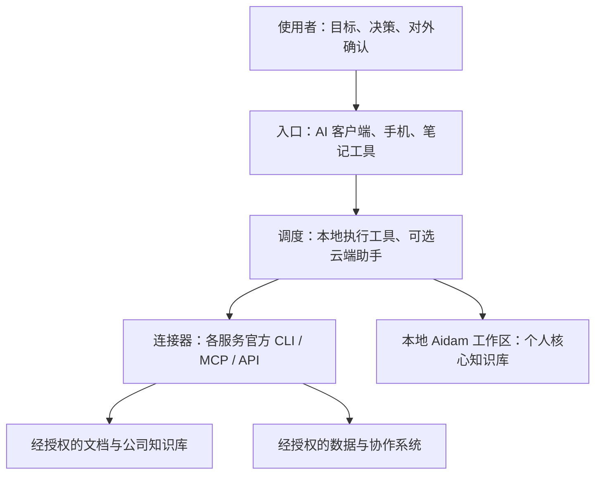

# 工作方式与四层架构

本地知识库是个人工作的权威来源。AI 工具负责执行，连接器负责访问服务，使用者负责决策和对外确认。不同工具通过文件和会话记录接力。

## 各层解决什么

| 层 | 责任 | 接入原则 |
|---|---|---|
| 入口 | 收集需求、阅读结果 | 可以只用一个工具 |
| 调度 | 读取规则、分解并执行任务 | 能执行的动作取决于实际工具权限 |
| 连接器 | 以使用者账号访问服务 | 通用能力可复用，账号与权限各自配置 |
| 知识与业务系统 | 留存成果、记录业务事实 | 私人资料本地保管，外部系统按权限读取 |

可选分工：本地工具做文件和开发；云端助手产出草稿和复核；企业协作工具处理获准访问的工作消息；笔记工具供人阅读。Starter 不自带这些产品或授权。

## 权威与版本

- 私人知识和未定稿成果以本地工作区为准。
- 某文档若已确定以外部正式版本为准，必须在桥接映射中标明；修改前先读取正式版本，再同步本地备份。
- 云端产物在人工检查并合并进本地正式位置前，视为草稿。
- 规则只维护 `system/AIDAM.md`；入口文件指向它。项目可增加更具体规则，但必须符合隐私边界。

## 跨工具接力

1. 当前工具将目标、成果位置、验证、未完成事项写进会话日志。
2. 完成会话以释放路径声明；接手工具先读项目 `.context.md`、最近日志及必要长期记忆。
3. 接手工具用自己的 entry 开新会话，再声明需要修改的路径。
4. 同一路径已有会话占用时停止修改，先协调移交；不得强行清除其他会话。

文件声明是协作约定，不是文件系统权限或编辑锁。Starter 不启动工具群聊或自动调用其他 AI。

## 目录生命周期

`active/` 放有明确目标的项目；`operations/` 放长期运营资产；`archive/年份-季度/` 放经使用者确认结束的项目；`tmp/` 放可丢弃文件。归档和清理均由人工明确触发，Starter 没有后台删除任务。

归档前写 `.archived.md`，说明日期、原因、关键成果和后续位置；排除可重新生成的依赖与构建缓存。
